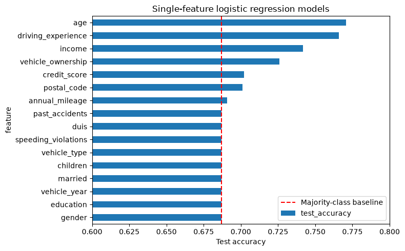

# Modelling car insurance claim outcomes

Finds the single best predictor of whether a customer makes an insurance claim, by fitting one logistic regression per feature and scoring each on held-out data.



## Data

`car_insurance.csv`: 10,000 customers. The data comes from the DataCamp project of the same name.

## Key results

- `age` (77.1%) and `driving_experience` (76.6%) are effectively tied as the best single feature, against a 68.7% baseline.
- Claim rates fall from 63% for drivers with under ten years of experience to 2% for those with 30 or more.
- Five features do no better than always predicting "no claim".

## Running the notebook

```bash
pip install -r requirements.txt
jupyter notebook notebook.ipynb
```
